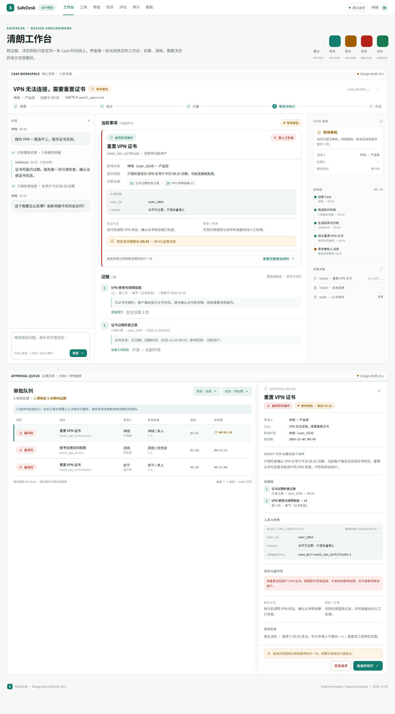
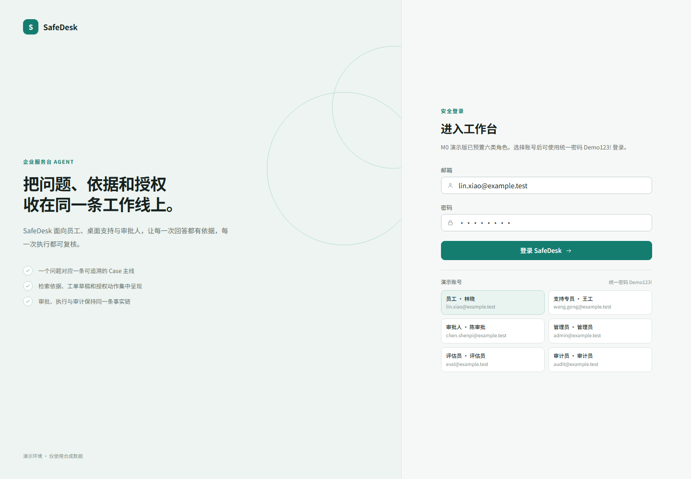

# SafeDesk 设计底稿

> 版本：v0.2  
> 状态：设计评审已通过，M0 工程骨架已落地  
> 依据：`E:\SafeDesk\SafeDesk-完整需求说明书.md`

## 文件索引

| 文件 | 内容 |
| --- | --- |
| `docs/design-system.md` | 色彩、排版、间距、动效、组件和文案规范 |
| `docs/ia-and-flows.md` | 信息架构、角色导航、页面清单、Case 五阶段和核心流程 |
| `docs/data-model-and-state-machines.md` | 实体关系、状态机、事务边界和检查点规则 |
| `docs/openapi-and-sse.md` | API 目录、关键 Schema、SSE 事件和错误契约 |
| `docs/wireframes/case-workspace.md` | Case 工作台三栏布局与各状态卡片 |
| `docs/wireframes/approval-queue.md` | 审批队列、详情抽屉和决定交互 |
| `docs/design-preview/index.html` | 可直接打开的静态视觉预览 |
| `docs/design-preview/preview.png` | Case 工作台与审批页的渲染截图 |

## 当前锁定

- 单人开发，按 6 周收敛 P0；优先保证纵向闭环。
- 模块化单体：Next.js + FastAPI + PostgreSQL/pgvector + Worker。
- 业务数据库是唯一事实源；LangGraph 只负责编排和检查点。
- 中文检索先采用 pgvector + pg_trgm，保留分词适配层。
- 视觉方向为“清朗工作台”：雾白、青绿、细边框、克制动效。
- Admin 可查看审批队列，但不自动拥有审批权。
- Employee 工单入口建议为本人只读；服务端强制资源归属。

## 预览

打开 `docs/design-preview/index.html` 可查看可缩放、可滚动的完整静态稿。

## 当前进度

- M0 已完成：Docker Compose、数据库初始迁移、登录/RBAC、Case 创建与时间线、角色化 Web 外壳。
- 设计系统、导航、Case 工作台和审批队列底稿继续作为 M1–M4 的实现依据。
- 启动方式、演示账号和验证状态见根目录 `README.md`。

## 下一步

1. 在具备 Docker Desktop 的环境执行 `docker compose up --build`，完成端到端冒烟。
2. M1：接入 Case 对话、Agent 编排骨架、检索证据面板和流式回答契约。
3. M2：工单、知识库与运营指标。
