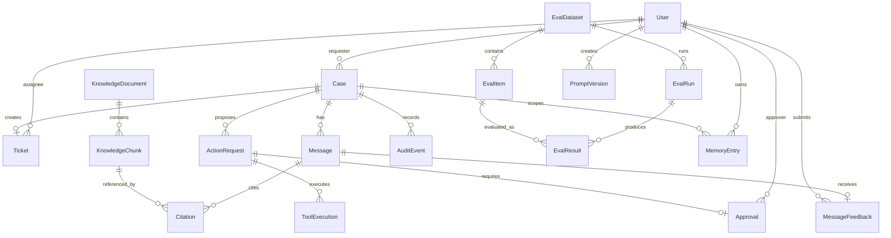
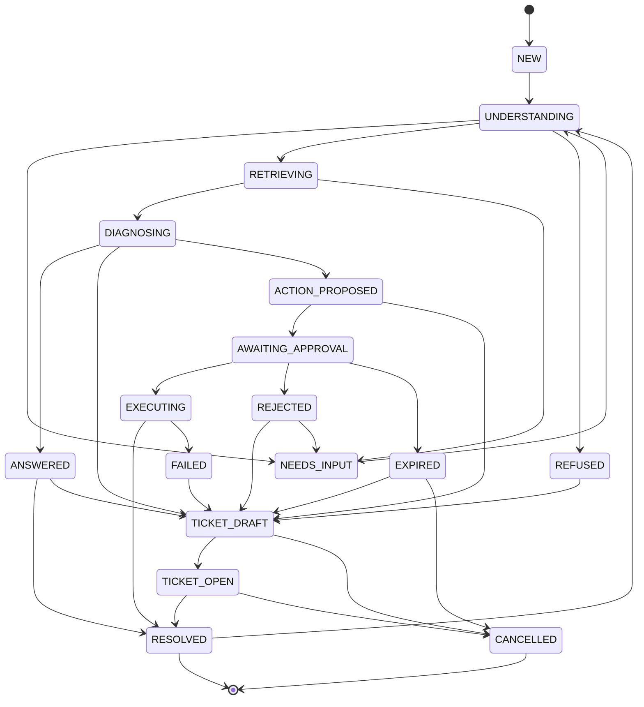
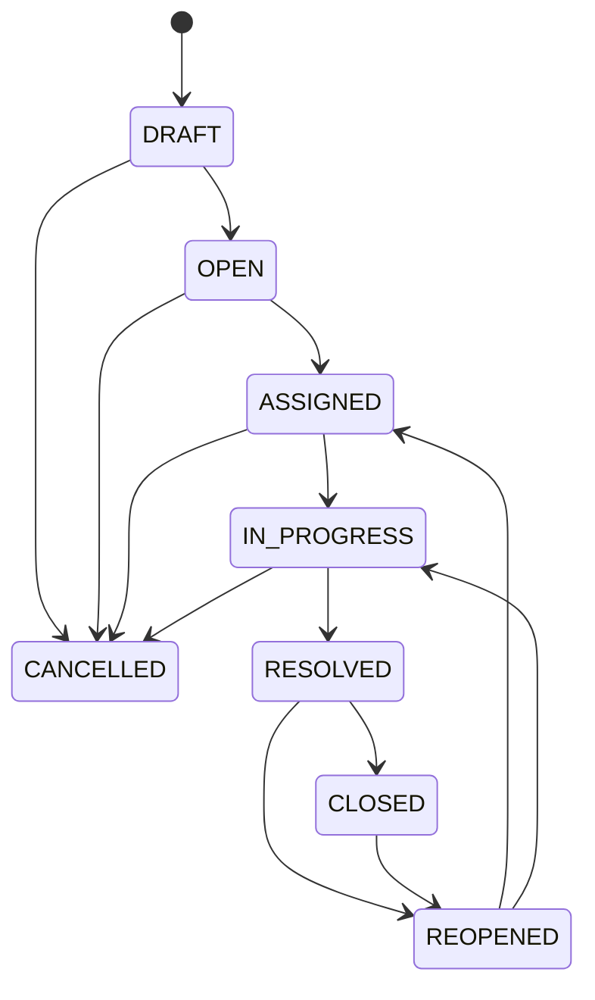
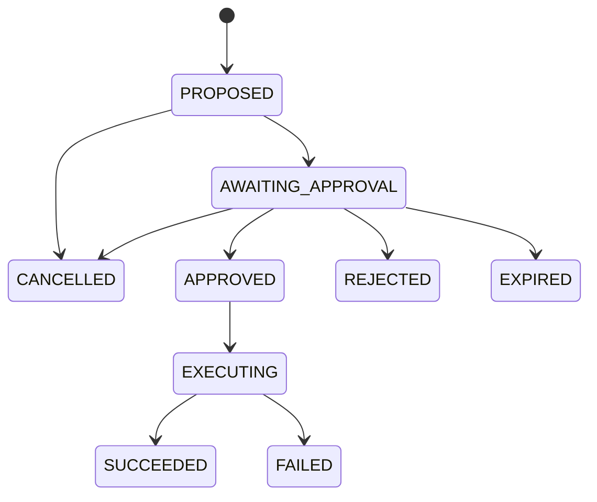
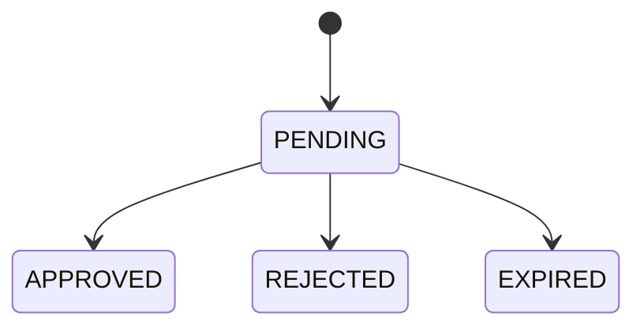
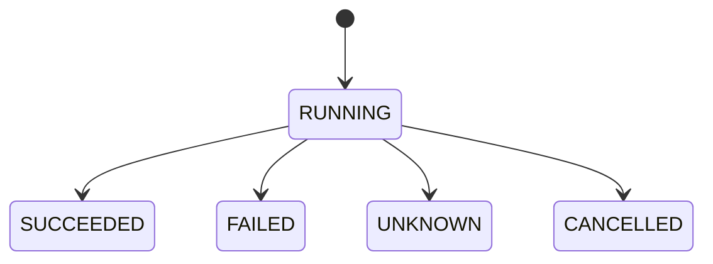

# SafeDesk 数据模型与状态机 v0.1

> 状态：M0–M4 已实现；本文保留目标模型与后续扩展说明，实际字段以 Alembic 迁移和 Pydantic Schema 为准
> 目标：让 Case、Ticket、Action、Approval 和审计共享同一事实源  
> 关联文档：`docs/ia-and-flows.md`、`docs/openapi-and-sse.md`

## 1. 核心原则

1. **业务数据库是唯一事实源**：工作流检查点保存编排恢复信息，但不能替代 Case、Action、Approval 的业务状态。
2. **状态变更必须可审计**：每次关键状态变化都有操作者、时间、原因和关联对象。
3. **写操作必须可恢复**：审批恢复、进程重启和网络重试都不能造成重复副作用。
4. **引用由服务端组装**：模型只选择 chunk ID，文档标题、页码、原文和版本来自数据库。
5. **审计只追加**：业务表允许更新，审计表不允许编辑或删除。
6. **先事务后执行**：外部工具调用不能放在长事务里；通过状态抢占、租约和幂等键保证一致性。

## 2. 实体概览

| 实体 | 作用 | 关键约束 |
| --- | --- | --- |
| User | 用户、角色、部门、技能 | 账号唯一；角色可多值或单独关联 |
| KnowledgeDocument | 文档元数据与状态 | 版本、ACL、内容哈希 |
| KnowledgeChunk | 可检索与引用片段 | 必须能定位到文档、页/章节、字符偏移 |
| Case | 一次完整服务事件 | 唯一活动主线；`thread_id` 稳定映射 |
| Message | 对话消息 | 区分用户/助手/系统；支持流式状态 |
| Citation | 回答引用的精确片段 | 引用必须来自 chunk，保存原文快照 |
| Ticket | 从 Case 生成的结构化工单 | 与 Case 双向关联；版本号 |
| ActionRequest | Agent 提议的工具调用 | 写操作必须关联审批；参数哈希 |
| Approval | 对 Action 的人工决定 | 唯一决定；禁止自审批高风险动作 |
| ToolExecution | 一次实际工具执行 | 幂等键唯一；区分成功/失败/未知 |
| AuditEvent | 只追加审计事件 | Case 时间线的安全投影来源 |
| EvalDataset / EvalItem | 固定评估数据 | 版本化；金标准不自动变化 |
| EvalRun / EvalResult | 一次评估及样本结果 | 保存 Prompt/模型/检索配置 |
| PromptVersion | Prompt 版本记录与激活状态 | `version` 唯一；应用层最多一个激活版本 |
| MessageFeedback | 回答反馈候选样本 | 同一用户对同一消息一条；不直接改知识 |
| MemoryEntry | 分层 Agent 记忆 | `CASE` 绑定 Case，`USER` 绑定用户；可删除、可过期 |
| ToolPolicy / SystemSetting | 工具策略与运行参数 | 服务端读取；变更写入配置审计 |

## 3. 关系图



## 4. 关键字段

### 4.1 User

```text
id, name, email, password_hash, role, department, skills, status,
approval_scopes, created_at, updated_at
```

- `role` MVP 采用单主角色 + 可选附加权限；服务端返回 `permissions`，前端不自行推断。
- `approval_scopes` 表示可审批的工具和部门范围；Admin 不自动拥有审批权。
- 不存储真实个人信息；演示数据使用合成姓名和邮箱。

### 4.2 KnowledgeDocument

```text
id, title, version, owner_id, effective_at, source_type, file_uri,
content_hash, acl, status, parse_error, chunk_count, created_at, updated_at
```

- `status`: `DRAFT | PROCESSING | READY | FAILED | DISABLED`。
- `acl` 保存部门/角色/用户范围；检索前必须服务端过滤。
- `content_hash` 用于重复检测（P1）和索引缓存失效。
- 删除文档不删除历史审计中的 citation 快照，只标记文档不可用。

### 4.3 KnowledgeChunk

```text
id, doc_id, doc_version, content, page, section, offset_start, offset_end,
acl_snapshot, embedding, metadata, created_at
```

- `offset_start/offset_end` 对应解析后纯文本位置；PDF 预留 `bbox`。
- `acl_snapshot` 用于排查索引时的权限边界，不作为实时 ACL 的唯一来源。
- 进入上下文的 chunk 数量默认 5–8，可配置。

### 4.4 Case

```text
id, title, requester_id, status, intent, confidence, thread_id,
current_node, assigned_agent_id, ticket_id, action_id,
workflow_version, created_at, updated_at, closed_at
```

- `thread_id` 与 `case_id` 稳定映射，重启后按映射恢复。
- `current_node` 是展示和诊断字段，不作为唯一状态依据。
- `workflow_version` 用于检查点 Schema 兼容性判断。

### 4.5 Message

```text
id, case_id, role, content, status, citations, model_version,
prompt_version, request_id, created_at
```

- `status`: `STREAMING | COMPLETE | STOPPED | FAILED`。
- 停止生成时保存已输出内容并标记 `STOPPED`，重试创建新消息，不覆盖旧消息。
- `citations` 可冗余保存引用 ID 列表，但引用详情仍从 Citation 表读取。

### 4.6 Citation

```text
id, message_id, chunk_id, doc_id, doc_version, quote, locator,
page, section, offset_start, offset_end, created_at
```

- `quote` 是检索时的原文快照，禁止模型改写。
- `locator` 保存前端跳转所需的页码/章节/偏移；PDF bbox 可选。
- 文档停用后仍可展示历史引用快照，但标记“来源不可用”。

### 4.7 Ticket

```text
id, case_id, title, description, category, priority, priority_reason,
affected_system, environment, error_message, urgency_reason,
suggested_assignee_id, suggested_assignee_reason, assignee_id,
status, fields, missing_fields, version, created_at, updated_at
```

- `fields` 使用 JSONB 保存可扩展字段，关键字段仍用独立列。
- `version` 用于乐观锁；PATCH 必须带期望版本。
- 分类和优先级的人工修正记录在审计事件中，不覆盖历史。

### 4.8 ActionRequest

```text
id, case_id, ticket_id, tool_name, args, args_hash, risk_level,
rationale, evidence_ids, status, requested_by, idempotency_key,
expires_at, created_at, updated_at
```

- `args_hash` 对规范化后的参数计算；审批后参数变化必须重新审批。
- `idempotency_key` 唯一；同一 Case、工具和业务意图只生成一个有效键。
- `risk_level`: `READ_ONLY | LOW | MEDIUM | HIGH`，MVP 写工具统一 HIGH。

### 4.9 Approval

```text
id, action_id, approver_id, decision, reason, decided_at, expires_at,
args_hash_at_decision, created_at
```

- `decision`: `APPROVED | REJECTED | EXPIRED`。
- P0 每个 Action 只允许一个有效决定；P1 双人复核改为多记录。
- 审批记录必须保存决定时的 `args_hash_at_decision`，执行前再次比对。

### 4.10 ToolExecution

```text
id, action_id, status, output_summary, error_code, idempotency_key,
attempt, lease_until, started_at, finished_at, created_at
```

- `status`: `RUNNING | SUCCEEDED | FAILED | UNKNOWN | CANCELLED`。
- `UNKNOWN` 表示外部调用结果不可确认，必须人工对账或通过只读验证判断，不能直接重试。
- `idempotency_key` 唯一索引，防止网络重试产生第二次副作用。

### 4.11 AuditEvent

```text
id, case_id, actor_id, actor_role, event_type, payload, trace_id,
request_id, result, prev_hash, created_at
```

- `payload` 中的密码、Token、密钥、手机号等必须脱敏。
- P0 通过数据库权限/触发器禁止 UPDATE/DELETE；P1 增加哈希链。
- Case 时间线是 AuditEvent 的安全投影，不另建第二套业务事件源。

### 4.12 PromptVersion

```text
id, version, name, system_prompt, is_active, created_by_id, created_at
```

- `version` 唯一；激活新版本时由应用层关闭其他版本的 `is_active`。
- 创建和激活均写入 `config.changed` 审计，包含版本、名称和激活状态。
- 未配置模型时回答链路使用本地规则基线；配置 OpenAI-compatible Provider 后，激活版本会作为真实系统提示词，失败时回退本地规则。

### 4.13 MessageFeedback

```text
id, message_id, user_id, rating, reason, comment, created_at, updated_at
```

- `rating`: `helpful | unhelpful`；`reason`: `inaccurate | no_citation | outdated | missing_steps | other | null`。
- `UNIQUE(message_id, user_id)`：同一用户重复提交时更新原记录，不产生多条反馈。
- 反馈只形成候选样本并写 `feedback.submitted` 审计，不自动修改文档、索引或模型。

### 4.14 EvalDataset、EvalItem、EvalRun 与 EvalResult

```text
EvalDataset: id, name, dataset_type, version, description, item_count,
             is_fixed, created_by_id, created_at
EvalItem:    id, dataset_id, ordinal, input, expected, labels, source, created_at
EvalRun:     id, dataset_id, label, prompt_version, model_config,
             retrieval_config, run_config, status, metrics, sample_count,
             created_by_id, created_at, finished_at
EvalResult:  id, run_id, item_id, actual, score, passed, failure_reason,
             citations, latency_ms, token_count, cost_usd, manual_verdict,
             manual_note, reviewed_by_id, reviewed_at, created_at
```

- `dataset_type`: `knowledge | triage | security`；固定集为 40/80/15 条，导入集最多 500 条。
- `EvalItem` 使用 `UNIQUE(dataset_id, ordinal)`；`EvalResult` 使用 `UNIQUE(run_id, item_id)`。
- Run 同时保存 Prompt、模型、检索和运行配置，便于复现实验；指标包含总体与分项样本量。
- 人工复核只更新 `manual_verdict/manual_note/reviewer/reviewed_at`，不覆盖自动评分和原始实际输出。
- 当前指标来自本地规则基线与 Mock 链路，延迟、Token 和成本为本地估算，不作为生产模型效果承诺。

### 4.15 ToolPolicy 与 SystemSetting

```text
ToolPolicy:    name, enabled, mock_mode, updated_at
SystemSetting: key, value, updated_at
```

- `ToolPolicy` 只管理代码注册表中已存在的工具，不允许界面新增可执行连接器；`mock_mode`: `success | fail | timeout`。
- `runtime_config` 保存检索 Top-K、最低相关度、最大上下文片段、最大步骤、审批 TTL、回归阈值和回答风格。
- Agent 相关字段包括 `answer_mode`（`auto | local | model`）、`memory_enabled`、`query_rewrite_enabled` 和 `agent_tools_enabled`。
- 运行参数在服务端被实际读取：会话检索、回答组装、审批创建、评估默认配置和 Run 比较门禁均使用对应值。
- `kill_switch` 保存全局写操作暂停状态与原因；工具或运行配置变更写入 `config.changed` 审计。

### 4.16 MemoryEntry

```text
id, user_id, case_id, scope, kind, key, value, confidence,
source_message_id, expires_at, created_at, updated_at
```

- `scope`: `CASE | USER`；`kind`: `fact | preference`。
- `CASE` 记忆绑定 `case_id` 和 `user_id`，保存使用环境、错误码和 Case 主题；不跨 Case 读取。
- `USER` 记忆绑定 `user_id`，保存显式回答偏好，默认 180 天过期；不包含隐式推断的敏感属性。
- 写入只针对 Case 请求人；读取、删除均校验 `user_id`，跨用户删除返回 404。
- `memory.written` 和 `memory.deleted` 审计记录作用域、键和来源消息，不复制完整敏感内容。

## 5. Case 状态机



### 5.1 状态语义

| 状态 | 用户可读标签 | 说明 |
| --- | --- | --- |
| `NEW` | 新问题 | Case 已创建，等待分析 |
| `UNDERSTANDING` | 正在理解 | 安全检查、意图识别、查询改写 |
| `RETRIEVING` | 正在检索 | ACL 过滤、混合检索、重排 |
| `DIAGNOSING` | 正在核对依据 | 证据充分性判断、只读诊断 |
| `NEEDS_INPUT` | 等待补充 | 缺少关键信息，等待用户回答 |
| `ANSWERED` | 已回答 | 已生成带引用回答 |
| `TICKET_DRAFT` | 工单待确认 | 草稿已生成，未创建 Ticket |
| `TICKET_OPEN` | 已转工单 | Ticket 已创建，等待人工处理 |
| `ACTION_PROPOSED` | 动作待确认 | 已生成 Action，尚未送审 |
| `AWAITING_APPROVAL` | 等待审批 | 已请求审批，流程暂停 |
| `EXECUTING` | 执行中 | 已批准，正在执行写操作 |
| `REJECTED` | 审批未通过 | 审批被拒绝，保留原因 |
| `EXPIRED` | 审批已过期 | 审批超时，动作不可执行 |
| `RESOLVED` | 已解决 | 回答或执行验证通过 |
| `FAILED` | 执行失败 | 无法自动恢复，需要人工路径 |
| `CANCELLED` | 已关闭 | 用户或管理员取消 |
| `REFUSED` | 无法处理 | 越权或超出能力范围 |

### 5.2 状态规则

- 只有服务端状态机可以迁移状态；前端按钮只是请求迁移。
- 每次迁移写入 AuditEvent，并记录 `from_status`、`to_status`、actor、reason。
- `AWAITING_APPROVAL` 期间不得执行写工具；取消 Case 后必须阻止恢复执行。
- `EXECUTING` 进入前必须完成原子抢占；同一 Action 只能有一个执行租约。
- `FAILED` 不自动回到 `DIAGNOSING`；必须进入人工处理或新建 Action。
- `RESOLVED` 重新打开时，保留原对话和证据，新建处理轮次。

## 6. Ticket 状态机



- 非法流转返回 `INVALID_STATE`，不静默忽略。
- 字段修改与状态流转分开；修改字段不自动改变状态。
- 关闭工单不关闭关联 Case；Case 与 Ticket 的状态各自独立。
- 重新打开保留历史处理记录，并新增时间线事件。

## 7. Action、Approval 与 Execution

### 7.1 Action 状态



### 7.2 Approval 状态



### 7.3 ToolExecution 状态



### 7.4 关键规则

- 所有写工具 MVP 必须经过审批；只读工具可以自动执行，但必须记录工具名、参数、结果摘要和 trace ID。
- 批准前再次校验：Action 状态、审批状态、`args_hash`、有效期、Case 状态、工具启用状态、Kill Switch、申请人权限。
- 只有审批人可以决定；申请人不能审批自己的高风险动作；Admin 不能绕过审批。
- 审批决定只能提交一次；重复提交按幂等处理。
- 执行失败后重试必须创建新的 Action 和审批，不复用已消费的审批。
- `ToolExecution.UNKNOWN` 必须先通过只读验证或人工对账确认，不能直接重试。

## 8. 事务与一致性

### 8.1 创建 Case 与消息

同一事务内：

1. 创建 Case，写入 requester 和初始状态。
2. 写入用户 Message。
3. 写入 `case.created` 和 `message.received` 审计事件。
4. 提交后启动工作流；工作流失败时 Case 进入可解释失败状态，而不是消失。

### 8.2 创建 Ticket

同一事务内：

1. 校验草稿与 Case 归属。
2. 创建 Ticket 并关联 Case。
3. 更新 Case 状态与 `ticket_id`。
4. 写入 `ticket.created` 审计事件。

### 8.3 审批决定

同一事务内：

1. `SELECT ... FOR UPDATE` 锁定 Action。
2. 校验审批人权限、非自审批、状态、有效期和参数哈希。
3. 写入 Approval 决定。
4. 更新 Action 状态。
5. 写入 `approval.approved` 或 `approval.rejected` 审计。
6. 提交后触发工作流恢复或转工单。

并发审批以服务端原子结果为准；后到请求返回状态冲突，不覆盖先到决定。

### 8.4 执行写操作

外部工具调用不能包在数据库长事务中，采用三段式：

1. **抢占事务**：锁定 Action，校验审批，`APPROVED → EXECUTING`，创建 `ToolExecution(RUNNING)`，写审计，提交。
2. **执行调用**：带超时调用 Tool Gateway；使用唯一幂等键。事务已提交，不占用数据库连接。
3. **结果事务**：更新 ToolExecution、Action、Case，写入执行与验证审计，提交。

进程在步骤 2 后崩溃时，恢复任务将执行标记为 `UNKNOWN` 或通过只读验证对账；绝不能盲目重放写操作。

### 8.5 审计与业务一致性

- 关键业务状态变化与审计事件尽量同事务提交。
- 若审计写入失败，业务事务回滚；不允许“已执行但无审计”。
- 外部工具已执行但结果事务失败时，保留 `RUNNING` 租约，由恢复任务对账；这是唯一需要补偿的事务边界。
- 所有审计事件带 `trace_id`、`request_id` 和 actor。

## 9. 工作流检查点

- `thread_id` 与 `case_id` 稳定映射，建议直接使用 `case_id` 派生。
- M3 使用显式状态机 + 数据库检查点实现等价能力，未引入 LangGraph 运行时；后续可在不改变业务表契约的前提下替换编排实现。
- 检查点保存节点、消息摘要、证据 ID、草稿 ID、Action ID、状态版本和 `workflow_version`。
- 进入 `await_approval` 前，必须已提交 Action、Approval 请求和审计；检查点不能领先于业务事实。
- 恢复前校验 Case 状态、Action 状态、Approval 决定、参数哈希、有效期和工具启用状态。
- 检查点缺失但业务 Action 仍待审批时，可从数据库重建最小工作流状态，而不是丢弃 Case。
- 检查点 Schema 升级必须版本化；无法迁移的旧检查点安全拒绝并记录原因。

## 10. 审计事件与时间线

### 10.1 事件类型

```text
case.created, case.updated, case.closed, case.reopened
message.received, answer.generated, answer.refused, answer.stopped
retrieval.completed, evidence.insufficient
ticket.drafted, ticket.created, ticket.updated, ticket.transitioned
tool.read_executed, tool.read_failed
action.proposed, action.cancelled
approval.requested, approval.approved, approval.rejected, approval.expired
tool.executed, tool.failed, tool.unknown
action.verified, action.verification_failed
feedback.submitted
eval.dataset_imported, eval.run_completed, eval.result_reviewed
config.changed, demo.reset
```

### 10.2 时间线投影

- 员工可见：消息、检索摘要、回答、工单、动作状态、审批结果（不含内部审批备注）、执行和验证结果。
- 支持专员可见：上述内容 + 工单修改记录、处理备注。
- 审批人可见：上述内容 + 审批材料、参数、审批历史。
- 审计员可见：全部审计字段，但敏感值脱敏。
- 时间线不直接返回原始 payload；由服务端按角色投影为安全字段。

## 11. 权限与资源范围

- 员工只能访问 `requester_id = current_user` 的 Case 和 Ticket。
- 支持专员只能访问其部门/技能组授权范围内的 Ticket 和关联 Case。
- 审批人只能看到与其审批范围匹配的 Action；不能审批自己发起的 Action。
- 审计员只读；不能修改任何业务表。
- 管理员可以管理配置和知识库，但不自动获得审批权。
- 评估员只能管理评估并只读知识，不进入看板、审计或系统配置。
- 审计员可读审计和看板，但不能运行评估或修改配置。
- 所有列表查询带服务端 scope 过滤，不能信任客户端传入的 `user_id`、`department` 或 `case_id`。

## 12. 索引与约束建议

```text
UNIQUE users.email
UNIQUE cases.thread_id
UNIQUE actions.idempotency_key
UNIQUE executions.idempotency_key
UNIQUE approvals.action_id, approvals.approver_id  -- P0 可用 action_id 唯一
INDEX cases.requester_id, cases.status, cases.updated_at
INDEX messages.case_id, messages.created_at
INDEX citations.message_id
INDEX tickets.status, tickets.priority, tickets.assignee_id
INDEX approvals.status, approvals.expires_at
INDEX audit_events.case_id, audit_events.created_at
INDEX audit_events.event_type, audit_events.created_at
INDEX chunks.doc_id
INDEX chunks.embedding USING ivfflat/hnsw  -- 按 pgvector 版本选择
UNIQUE prompt_versions.version
UNIQUE eval_datasets.name
UNIQUE eval_items.dataset_id, eval_items.ordinal
UNIQUE eval_results.run_id, eval_results.item_id
UNIQUE message_feedback.message_id, message_feedback.user_id
INDEX eval_runs.dataset_id, eval_runs.status, eval_runs.created_at
INDEX eval_results.run_id, eval_results.item_id
INDEX message_feedback.message_id, message_feedback.user_id
```

- JSONB 只用于可扩展字段，不把状态、权限和关键关联放进不可索引的 JSON。
- 所有时间存 UTC，接口返回带时区偏移的 ISO 8601。
- 金额、Token 成本使用定点数，不使用浮点数。

## 13. 数据保留与删除

- Case、Ticket、AuditEvent 演示环境保留 180 天；生产保留期可配置。
- 文档删除后索引和缓存失效；Citation 快照保留最小必要信息。
- 用户删除采用停用而不是物理删除，保留审计关联。
- 一键重置演示数据只允许 Admin 操作，清理 Case、工单、审批、执行、评估 Run、反馈、Prompt/配置覆盖和知识文档，恢复固定演示数据；审计历史保留并写入 `demo.reset` 审计。

## 14. 待确认的实现细节

| 问题 | 建议默认 |
| --- | --- |
| P0 Approval 是否一 Action 一条 | 是；P1 双人复核再扩展为多条 |
| Action 失败后是否复用 | 否；新建 Action 和新审批 |
| Case 时间线是否单独建表 | 否；从 AuditEvent 投影 |
| `UNKNOWN` 如何展示 | 显示“执行结果待确认”，禁止写成成功或失败 |
| 检查点缺失是否拒绝恢复 | 不直接拒绝；先尝试从业务表重建最小状态 |
