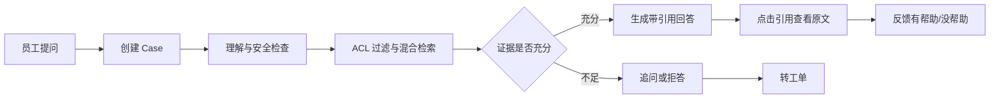
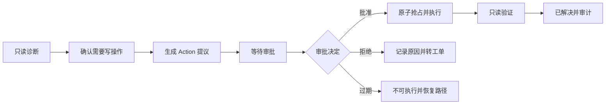

# SafeDesk 信息架构与核心流程 v0.1

> 状态：M0–M3 已实现；评估、看板与完整配置页面仍为 M4 设计
> 目标：把“知识问答、工单分诊、审批执行”收敛到同一个 Case 主线上  
> 关联文档：`docs/design-system.md`、`docs/data-model-and-state-machines.md`、`docs/openapi-and-sse.md`

## 1. 产品结构

SafeDesk 采用“一个应用外壳 + 若干治理模块 + 一个核心 Case 工作台”的结构：

```text
应用外壳（角色化导航、身份、演示切换）
├─ Case 工作台 /cases/:id       核心：对话、证据、草稿、动作、时间线
├─ 新建问题 /chat                入口：创建 Case、最近会话、示例问题
├─ 工单 /tickets                辅助：分派、处理、状态流转
├─ 审批 /approvals              治理：队列、材料、决定、过期
├─ 知识库 /knowledge            治理：导入、解析、切分、启停、重建索引
├─ 评估 /evaluations            治理：数据集、运行、对比、人工判定
├─ 审计 /audit                  治理：事件查询、Case 还原、只读
├─ 看板 /dashboard              运营：解决率、转单率、审批、延迟
└─ 配置 /settings               管理：用户、分类、工具、Prompt、重置
```

### 1.1 核心设计判断

- Case 是唯一业务主线；Ticket、Action、Approval 都是它的关联对象，不做三个互不相干的产品。
- `/cases/:id` 是最重要的页面，其他页面服务于它的输入、治理或复盘。
- 用户不需要理解内部节点名；页面展示五阶段，精确状态放在状态标签和时间线里。
- 每个页面只保留一个当前主操作，避免“什么都能点”。
- 所有权限过滤由服务端返回的 `permissions` 驱动，前端只负责呈现。

## 2. 角色与导航

### 2.1 导航矩阵

| 导航项 | Employee | Support Agent | Approver | Admin | Evaluator | Auditor |
| --- | --- | --- | --- | --- | --- | --- |
| 新建问题 | 是 | 是 | 是 | 是 | 否 | 否 |
| 我的 Case | 是 | 是 | 是 | 是 | 否 | 只读授权范围 |
| 工单 | 仅本人只读 | 是 | 只读 | 是 | 否 | 否 |
| 审批队列 | 否 | 否 | 是 | 只读队列 | 否 | 否 |
| 知识库 | 否 | 否 | 否 | 是 | 只读 | 否 |
| 评估 | 否 | 否 | 否 | 是 | 是 | 否 |
| 审计 | 否 | 有限 | 有限 | 是 | 否 | 是 |
| 看板 | 否 | 是 | 是 | 是 | 否 | 是 |
| 配置 | 否 | 否 | 否 | 是 | 否 | 否 |

### 2.2 导航决策

- 顶部导航只展示当前角色可进入的模块，不展示灰色禁用项。
- `Admin` 可以查看审批队列，但只有同时具备对应工具和部门审批范围时才显示批准/拒绝。
- `Employee` 的“工单”入口建议保留为本人只读列表；若 MVP 实现成本过高，可先从 Case 内跳转关联工单，但服务端仍需支持本人只读校验。
- 演示环境在顶部右侧提供“演示身份”切换；生产环境隐藏。切换身份后刷新当前 Case 的权限视图，不丢失 Case。
- 导航不按部门做二级菜单；部门差异体现在数据过滤和权限，不体现在页面结构。

## 3. 页面清单与优先级

| 页面 | 路由 | 优先级 | 设计重点 |
| --- | --- | --- | --- |
| 登录 | `/login` | P0 | 演示账号、安全提示、清晰错误 |
| 新建问题 | `/chat` | P0 | 低门槛输入、最近 Case、示例问题 |
| Case 工作台 | `/cases/:id` | P0 | 三栏、证据、草稿、动作、时间线 |
| 审批队列 | `/approvals` | P0 | 风险与剩余时间排序、材料完整 |
| 工单列表 | `/tickets` | P0 | 筛选、优先级、处理人、状态 |
| 工单详情 | `/tickets/:id` | P0 | 字段、证据、对话摘要、时间线 |
| 知识库 | `/knowledge` | P0 | 导入、状态、切分预览、重建索引 |
| 评估控制台 | `/evaluations` | P0 | 数据集、运行、对比、样本详情 |
| 审计日志 | `/audit` | P0 | 过滤、只读、Case 还原 |
| 运营看板 | `/dashboard` | P0 | 关键指标、样本量、时间范围 |
| 系统配置 | `/settings` | P0 | 用户、分类、工具、Prompt、重置 |

页面优先级不代表开发顺序；开发仍按纵向闭环推进。视觉打磨优先投入 Case 工作台和审批队列，其他页面沿用同一套组件。

## 4. Case 五阶段映射

需求文档中的内部状态很多，界面将其聚合为五个阶段，避免顶部进度条变成状态字典。

| 阶段 | 内部状态 | 用户看到的说明 |
| --- | --- | --- |
| 受理 | `NEW`、`UNDERSTANDING` | 正在理解问题 |
| 查证 | `RETRIEVING`、`DIAGNOSING`、`NEEDS_INPUT` | 正在查找依据 / 等待补充 |
| 方案 | `ANSWERED`、`TICKET_DRAFT`、`TICKET_OPEN`、`REFUSED` | 已给出答案 / 工单待确认 / 已转工单 / 无法处理 |
| 审批与执行 | `ACTION_PROPOSED`、`AWAITING_APPROVAL`、`EXECUTING`、`REJECTED`、`EXPIRED`、`FAILED` | 等待审批 / 执行中 / 审批未通过 / 已过期 / 执行失败 |
| 完成 | `RESOLVED`、`CANCELLED` | 已解决 / 已关闭 |

### 4.1 展示规则

- 顶部阶段条只显示五个阶段，当前阶段用青绿高亮，已完成阶段用勾选图标。
- 精确状态使用状态标签，例如“等待审批”“审批已过期”“执行失败”。
- 阶段条与状态标签冲突时，以服务端 Case 状态为准。
- 拒绝、过期、失败不是“回到上一步”，而是明确异常分支；时间线必须保留原因。
- Case 关闭后仍可查看历史，但所有写操作入口不可用。

## 5. 核心流程

### 5.1 流程 A：知识库可直接回答



界面要点：

- 提问后立即显示“正在理解问题”，随后显示“正在检索知识库”和“正在核对证据”。
- 回答卡先给结论，再给步骤；事实性结论逐条带 `[1]`、`[2]` 引用。
- 引用面板与回答卡并列，不把引用藏进折叠菜单。
- 点击引用打开原文阅读器；PDF 定位到页并高亮片段，Markdown 定位到章节。
- 反馈入口放在回答卡底部，原因选项不打断阅读。

### 5.2 流程 B：信息不足转工单


界面要点：

- 追问只问当前最关键的 1–3 个字段，不用长表单打断对话。
- 草稿卡显示分类、优先级、理由、处理人推荐、缺失字段和关联证据。
- 分类与优先级以“建议值”呈现，允许人工覆盖；覆盖后保留修改前后值。
- 未确认前不得创建 Ticket；创建后 Case 与 Ticket 双向关联。
- 用户补充信息后，草稿在原位更新，不生成多张重复卡片。

### 5.3 流程 C：敏感写操作与审批



界面要点：

- Action 卡展示“做什么、影响谁、为什么、证据、参数、风险、验证、回滚、有效期”。
- 非审批人只看到“等待审批”和预计剩余时间，不显示批准/拒绝按钮。
- 审批人从 `/approvals` 打开抽屉，看到完整材料后批准或拒绝。
- 批准前二次确认必须复述动作和影响对象，不使用空泛的“确定”。
- 审批通过后，Case 页面自动从“等待审批”切到“执行中”，再切到“验证结果”；通过事件订阅或轮询更新。
- 执行结果必须成对出现：执行回执 + 只读验证结果，不能只显示“成功”。

### 5.4 流程 D：越权或超出知识范围


界面要点：

- 拒答不是错误页，也不是普通回答卡；使用明确的“无法处理此请求”卡片。
- 不展示内部策略、系统 Prompt 或安全规则细节。
- 必须提供至少一个安全替代入口。
- 拒答事件写入审计，但不在普通用户界面展示内部审计字段。

### 5.5 流程 E：审批拒绝、过期与执行失败

- 拒绝：显示拒绝人、时间和原因；提供“转工单”和“继续补充信息”两个恢复路径。
- 过期：显示“审批已过期”，动作不可执行；提供“重新发起审批”或“转工单”。
- 执行失败：区分“未执行”“执行结果未知”“执行失败可重试”“部分成功”；不允许把未知结果标成成功。
- 任何恢复动作都创建新事件，不覆盖原审批和执行记录。

### 5.6 跨角色协作

```text
员工创建 Case
  → 支持专员查看/修正工单
  → Agent 提议动作
  → 审批人批准/拒绝
  → 系统执行并验证
  → 审计员复盘
```

- 每个角色看到的是同一个 Case 的不同投影，不是复制出来的多份数据。
- 员工看到“等待审批”，审批人看到“待处理”；两边的状态由同一业务状态驱动。
- 演示时通过顶部身份切换模拟跨角色协作；生产环境通过账号和权限隔离。

## 6. 页面设计要点

### 6.1 登录 `/login`

- 左侧是简短产品说明和三条能力边界，右侧是登录表单；不使用营销大图。
- 演示环境提供六类账号快捷选择，并明确标注“演示账号，仅合成数据”。
- 登录失败显示具体原因，不暴露账号是否存在。
- 登录后按角色跳转：Employee → `/chat`，Support → `/tickets`，Approver → `/approvals`，Admin → `/dashboard`，Evaluator → `/evaluations`，Auditor → `/audit`。

### 6.2 新建问题 `/chat`

- 顶部一句清晰引导：“描述你遇到的 IT 或行政问题，系统会先查找内部依据。”
- 中间是大输入区，支持多行、附件入口（P1）和发送快捷键。
- 下方展示最近 5 个 Case 和三个示例问题：VPN 无法连接、打印机报错、账号被锁定。
- 提交后立即创建 Case 并跳转 `/cases/:id`，不在首页原地堆积聊天记录。

### 6.3 Case 工作台 `/cases/:id`

详细布局见 `docs/wireframes/case-workspace.md`。核心约束：

- 三栏：对话 / 当前主卡与证据 / 状态与时间线。
- 顶部显示 Case 标题、精确状态、当前阶段和责任人。
- 中间只突出一个当前主卡；历史卡片折叠为摘要。
- 证据、工单草稿、动作卡共享同一套卡片骨架，但内容形态不同。
- 输入框固定在对话栏底部；生成中允许停止，失败后允许重试。
- 关闭的 Case 显示只读提示和重新打开入口。

### 6.4 审批队列 `/approvals`

详细布局见 `docs/wireframes/approval-queue.md`。核心约束：

- 默认按风险等级、剩余有效期排序；临期项有文字和图标提示。
- 列表只呈现判断所需信息，完整材料在抽屉中。
- 抽屉固定展示证据、参数、影响范围、验证方式和回滚说明。
- 批准前二次确认；拒绝原因必填。
- 批准或拒绝后，列表和 Case 状态同步更新，显示流程恢复结果。

### 6.5 工单 `/tickets`、`/tickets/:id`

- 列表支持状态、分类、优先级、处理人、时间筛选和关键词搜索。
- 工单详情顶部展示状态、分类、优先级、处理人和关联 Case。
- 中部按“字段 / 证据 / 对话摘要 / 动作记录”分组；右侧或底部是时间线。
- 修改字段使用乐观锁；冲突时显示“内容已被他人更新”，提供刷新和重新编辑。
- 非法状态流转不显示为可点击按钮；服务端仍返回明确错误。

### 6.6 知识库 `/knowledge`

- 上传区与文档列表分开；上传后立即显示 `PROCESSING`，失败显示原因和重试。
- 文档详情包含元数据、ACL、版本、解析状态、切分预览和引用定位样例。
- 切分预览必须能看出 chunk 边界、页码/章节和 ACL，不展示纯文本大块。
- 启停、删除、重建索引为危险或重操作，需要二次确认并写审计。
- 检索测试可作为管理员辅助工具，但不作为普通员工入口。

### 6.7 评估 `/evaluations`

- 三个层次：数据集 → Eval Run → 样本结果。
- 运行列表展示配置、状态、指标、Token 成本和耗时。
- 对比视图并排显示两版 Prompt/模型/检索配置，只高亮差异和关键指标。
- 样本详情展示输入、期望、实际、引用、失败原因、人工判定和备注。
- 指标旁必须显示样本量；小样本不显示成绝对结论。

### 6.8 审计 `/audit`

- 顶部过滤器：Case、用户、事件类型、工具、时间范围。
- 表格只读，无编辑和删除入口；行展开显示脱敏 payload。
- 从审计事件可跳回 Case 时间线或审批详情。
- 导出为 P1，入口可先隐藏，避免出现不可用按钮。

### 6.9 看板 `/dashboard`

- 第一屏只展示六类关键数字：Case 总量、知识解决率、转工单率、审批请求、拒绝、失败。
- 第二层展示分类分布、优先级分布、审批通过率和平均等待时间。
- 所有图表标注时间范围和样本量；无数据时说明原因。
- 不使用炫技动画；数字比图形更重要。

### 6.10 配置 `/settings`

- 按标签分组：用户与角色、分类与优先级、工具与策略、Prompt 版本、演示数据。
- 关键配置变更显示前后值，并要求二次确认。
- 工具只能启停和配置策略，不能在界面任意新增可执行工具。
- 一键重置演示数据必须显示影响范围，并记录操作者。

## 7. 响应式策略

| 断点 | 策略 |
| --- | --- |
| ≥ 1440px | 完整三栏；侧栏和证据卡并排 |
| 1180–1439px | 三栏收窄；次要信息折叠 |
| 900–1179px | 右栏变抽屉；对话 + 主卡 |
| < 900px | 单栏顺序：对话 → 主卡 → 证据 → 时间线；输入吸底 |
| < 600px | 导航收进菜单；表格变卡片；审批操作使用全宽按钮 |

移动端是基础可用，不是主要演示场景；关键流程仍必须能完成。

## 8. 演示模式

- 顶部“演示身份”可切换 Employee、Support、Approver、Auditor。
- 演示前提供“重置演示数据”，恢复文档、Case、工单、审批和 Mock 工具状态。
- 示例问题固定三条，保证演示可复现。
- Mock 工具提供成功、失败、超时三种状态，但普通用户界面不暴露“Mock”实现细节，只在演示提示中说明。
- 演示账号只使用合成数据，登录页明确标注。

## 9. 全局交互规则

- 一个视图一个主操作；危险操作永远不是默认焦点。
- 状态改变后必须有文字反馈，不能只变色。
- 所有长任务显示当前步骤；允许离开页面后从时间线恢复。
- URL 保存筛选、标签页和选中的对象，刷新不丢上下文。
- 删除、停用、重置、批准、拒绝均需确认；确认内容说明后果。
- 权限不足显示可返回的安全路径，不显示空白页。
- 错误信息包含请求 ID 和重试入口；用户可复制给管理员。
- 任何未完成的审批动作在 Case 关闭后都不得继续执行。

## 10. 需要在实现前确认的契约问题

| 问题 | 建议默认 |
| --- | --- |
| Employee 是否能访问 `/tickets` | 开放本人只读列表；服务端强制 `requester_id = me` |
| Admin 是否可批准 | 只读队列；批准需对应工具和部门审批范围 |
| Case 状态与 Action 状态谁做主 | Case 状态做主视图；Action 卡展示自身状态，避免重复大标签 |
| 移动端范围 | 基础可用；验收以 1280px 桌面为主 |
| PDF 精确定位 | P0 页码跳转 + 文本高亮；bbox 预留，不阻塞 MVP |
| 审批页是否显示模型置信度 | 不展示未经校准的百分比；展示证据充分性和来源数量 |
